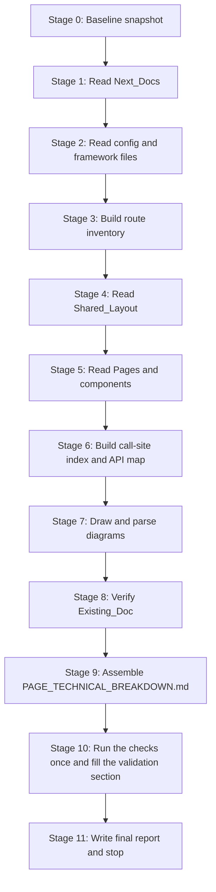

# Design Document

## Overview

This design describes how the Author produces one file, `PAGE_TECHNICAL_BREAKDOWN.md`, at the repository root, and how the Author proves the file is complete and correct. The deliverable is documentation. No file in Application_Source changes, and no file other than the deliverable is added to the repository.

The design has four parts:

1. A research method that fixes the order in which Next_Docs and Application_Source are read, so that every rendering claim is checked against the Next.js 16 docs before it is written.
2. A document skeleton with a per-page template and a per-row template, so every Page and every UI_Section has the same shape.
3. Derivation rules for rendering labels, API call sites, API classifications, and counts, so that tables follow from evidence and not from judgment.
4. A validation pipeline (path existence, Mermaid parse, secret scan, git status, totals reconciliation) that the Author runs after writing and records in the document.

Design decisions that go beyond the wording of the requirements are listed in [Decisions and Assumptions](#decisions-and-assumptions).

### Facts about the repository found while designing

These facts shape the method. They are leads for the Author, not findings. The Author confirms each one by reading the file or doc during research and writes it into the Breakdown_Document only after confirmation.

| Fact                                                                                                                                                                                                                                                                                      | Where seen                                          | Effect on the method                                                                                                                                                                                                                                                        |
| ----------------------------------------------------------------------------------------------------------------------------------------------------------------------------------------------------------------------------------------------------------------------------------------- | --------------------------------------------------- | --------------------------------------------------------------------------------------------------------------------------------------------------------------------------------------------------------------------------------------------------------------------------- |
| The working tree is dirty. Tracked files such as `app/api/products/route.js`, `app/shop/page.jsx`, `lib/content.js`, and `components/products/ShopBrowser.jsx` are modified, and `app/error.jsx`, `app/loading.jsx`, `app/shop/loading.jsx`, `app/shop/[slug]/loading.jsx` are untracked. | `git status --short`                                | A commit hash alone does not describe what the Author read. The snapshot records the hash, a dirty-tree flag, and a content fingerprint (see [Source snapshot](#source-snapshot-and-baseline)).                                                                             |
| `app/layout.jsx` exports `dynamic = 'force-dynamic'` and calls `getContent()`.                                                                                                                                                                                                            | `app/layout.jsx`                                    | This may make every route dynamic. The Author must read how Next.js 16 treats a layout-level `dynamic` export before labeling any Page.                                                                                                                                     |
| `next.config.js` does not set `cacheComponents`.                                                                                                                                                                                                                                          | `next.config.js`                                    | The previous caching model applies. `dynamic` and `revalidate` are documented in `node_modules/next/dist/docs/01-app/02-guides/caching-without-cache-components.md`, and the Next.js 16 route segment config page states they are removed only when Cache Components is on. |
| `node_modules/next/dist/docs/01-app/03-api-reference/03-file-conventions/middleware.md` states `middleware.js` is deprecated in Next.js 16 and renamed to `proxy.js`. The repo still has `middleware.js`.                                                                                 | Next_Docs, repo root                                | Requirements 6.8 and 8.6 apply. The Breakdown_Document records the deprecation notice and cites both `middleware.md` and `proxy.md`.                                                                                                                                        |
| `middleware.js` redirects `/admin` paths to `/` with `NextResponse.redirect`, and sets headers on all matched requests.                                                                                                                                                                   | `middleware.js`                                     | Requirement 8.3 asks for the redirect target and status. The Author reads the `NextResponse.redirect` doc for the default status instead of assuming it.                                                                                                                    |
| `netlify.toml` contains only build settings. The edge function binds its own route through `export const config = { path: '/edge' }`.                                                                                                                                                     | `netlify.toml`, `netlify/edge-functions/rewrite.js` | The route binding for Requirement 8.5 comes from the function file, and the document says `netlify.toml` has no binding.                                                                                                                                                    |
| `docs/PAGES_AND_APIS.md` exists (296 lines).                                                                                                                                                                                                                                              | `docs/`                                             | It is read last (see research order), so it cannot anchor the Author's conclusions.                                                                                                                                                                                         |
| No Mermaid tooling is installed in the project. `mmdc` is not on the PATH.                                                                                                                                                                                                                | `node_modules`, shell                               | The validation pipeline installs tooling in a temporary directory outside the repository. If installation is blocked, the Mermaid step is marked Blocked.                                                                                                                   |

## Architecture

The work is a pipeline with one artifact. Each stage reads from the previous stage's notes and writes to a scratch directory outside the repository. Only the last stage writes into the repository.



### Scratch workspace

The Author keeps notes, the call-site index, the baseline manifest, and the validation scripts in a directory created with `mktemp -d` (referred to below as `$SCRATCH`). The directory is outside the repository, so Requirement 1.2 holds. The scripts are not committed. Their commands are copied into the final validation section so that a reviewer can repeat them.

### Source snapshot and baseline

Stage 0 runs before any reading and writes three things to `$SCRATCH`:

1. `git rev-parse HEAD` and the ISO date. These go into the Breakdown_Document under "Source snapshot" (Requirement 2.4).
2. `git status --porcelain` output, saved as `baseline.status`.
3. A manifest of content hashes, saved as `baseline.manifest`. It holds `git diff | shasum -a 256` for tracked changes and `shasum -a 256` for each untracked file outside `.kiro/` and outside the deliverable.

Because the tree is already dirty and the user may edit files during the work, the snapshot line in the document reads like: "Read at commit `<short hash>` on `<date>` with uncommitted changes in the working tree, fingerprint `<first 12 chars of the manifest hash>`". Immediately before the final validation, the Author recomputes the manifest. If a file the Author cited has changed since Stage 0, the Author re-reads that file and updates the affected rows before continuing.

## Research Method

### Order of reading

The order moves from framework rules to project configuration, then to code, and puts the Existing_Doc last. Each group has a purpose, and the Author does not assert a behavior in a later stage until the group that covers it has been read.

**Group A: Next_Docs (Stage 1).** All paths are relative to `node_modules/next/dist/docs/01-app/`. Read in this order.

| Order | Path                                                                                                                                      | Needed for                                                                                        |
| ----- | ----------------------------------------------------------------------------------------------------------------------------------------- | ------------------------------------------------------------------------------------------------- |
| A1    | `04-glossary.md`                                                                                                                          | Term definitions used in the rendering definitions section (Req 6.1).                             |
| A2    | `02-guides/rendering-philosophy.md`                                                                                                       | SSR, SSG, and component-level rendering in App Router terms.                                      |
| A3    | `01-getting-started/03-layouts-and-pages.md`                                                                                              | `layout`, `page`, nested layouts, dynamic segments.                                               |
| A4    | `01-getting-started/05-server-and-client-components.md` and `02-guides/server-and-client-boundary.md`                                     | `"use client"` boundary, server HTML versus hydration (Req 6.3).                                  |
| A5    | `01-getting-started/06-fetching-data.md`                                                                                                  | Where data fetching runs and what makes a route dynamic.                                          |
| A6    | `01-getting-started/08-caching.md` and `02-guides/caching-without-cache-components.md`                                                    | `dynamic`, `revalidate`, `fetchCache`, `fetch` cache options in the model this project uses.      |
| A7    | `01-getting-started/09-revalidating.md`, `02-guides/how-revalidation-works.md`, `02-guides/incremental-static-regeneration.md`            | ISR labeling rule and revalidation triggers.                                                      |
| A8    | `02-guides/public-static-pages.md` and `02-guides/streaming.md`                                                                           | What makes a page static, and how `loading` streams.                                              |
| A9    | `03-api-reference/03-file-conventions/02-route-segment-config/index.md`, `dynamicParams.md`                                               | Segment config options and the v16.0.0 change notes (Req 6.8).                                    |
| A10   | `03-api-reference/04-functions/generate-static-params.md`, `connection.md`, `cookies.md`, `headers.md`                                    | Static params and dynamic APIs (Req 3.4, 6.4).                                                    |
| A11   | `03-api-reference/03-file-conventions/layout.md`, `template.md`, `loading.md`, `error.md`, `not-found.md`, `page.md`, `dynamic-routes.md` | Special_File behavior and trigger conditions (Req 8.2).                                           |
| A12   | `01-getting-started/10-error-handling.md`                                                                                                 | Error boundary scope, `error.jsx` must be a Client Component, root `error` versus `global-error`. |
| A13   | `01-getting-started/15-route-handlers.md`, `03-api-reference/03-file-conventions/route.md`, `04-functions/next-response.md`               | Route handler caching, methods, status behavior (Req 8.1).                                        |
| A14   | `03-api-reference/03-file-conventions/middleware.md`, `proxy.md`, `01-getting-started/16-proxy.md`, `02-guides/redirecting.md`            | Middleware deprecation, matcher, redirect status (Req 8.3, 8.6).                                  |
| A15   | `03-api-reference/05-config/01-next-config-js/redirects.md`, `rewrites.md`, `cacheComponents.md`, `reactCompiler.md`, `images.md`         | Redirect and rewrite semantics, and confirmation that `cacheComponents` is off by default.        |
| A16   | `03-api-reference/07-edge.md` and `02-guides/environment-variables.md`                                                                    | Edge runtime context and env var handling (Req 8.7).                                              |

Every file actually opened is added to the "Next_Docs consulted" list in the document, written as a path relative to the repository root (for example `node_modules/next/dist/docs/01-app/04-glossary.md`), so that V2 can test it (Req 6.7). A file listed in the table that the Author did not open is not listed in the document (Req 6.7). A file not in the table that the Author did open is added.

While reading Group A, the Author keeps a note for each doc that states a deprecation, rename, or version change (`version: draft` frontmatter, "deprecated", "renamed", "removed", "v16"). These notes feed Requirements 6.8 and 8.6.

**Group B: configuration and framework files (Stage 2).** `package.json` (versions and scripts), `next.config.js`, `middleware.js`, `netlify.toml`, `netlify/edge-functions/rewrite.js`, `jsconfig.json`, `config/siteFeatures.js`, `lib/features.js`, `.env.example` (names only). The Author does not open `.env`. The Author lists variable names from `.env.example` and from `process.env.*` grep hits.

**Group C: root `app/` files (Stage 2, continued).** `app/layout.jsx`, `app/template.jsx`, `app/loading.jsx`, `app/error.jsx`, `app/not-found.jsx`, `app/shop/loading.jsx`, `app/shop/[slug]/loading.jsx`.

**Group D: route inventory (Stage 3).** Built from the file system and the config, not from the Existing_Doc (see [Route inventory derivation](#route-inventory-derivation)).

**Group E: Shared_Layout (Stage 4).** In order: `components/layout/ContentProvider.jsx`, `lib/content.js`, `lib/clientContent.js`, `components/layout/InquiryProvider.jsx`, `Navbar.jsx`, `MobileMenu.jsx`, `SearchDialog.jsx`, `lib/siteSearch.js`, `data/search.js`, `BagDrawer.jsx`, `Footer.jsx`, `MainShell.jsx`, `SmoothScroll.jsx`, `SplashScreen.jsx`, `PageTransition.jsx`, `useOverlay.js`. The Author also opens `components/header.jsx` and `components/footer.jsx` (lowercase, starter files) and records whether any route imports them.

**Group F: Pages and their components (Stage 5).** One page at a time, in the order of the route inventory. For each page: open `page.jsx`, list its imports, open each imported component and its data helper, and note every `"use client"` directive, event handler, `fetch` call, and storage access. Pages are processed in this order so that shared data modules are understood before their later callers: `/`, `/shop`, `/shop/[slug]`, `/collections/[slug]`, `/classics`, `/articles`, `/articles/[slug]`, `/contact`, `/size-guide`, `/d-color-diamond`, `/why-xxxx`, `/privacy`, `/terms`, then the Starter_Demo_Pages.

**Group G: Route_Handlers and server helpers (Stage 5, continued).** `app/api/contact/route.js` with `lib/mail.js`, `lib/firebase-admin.js`; `app/api/products/route.js` with `lib/catalog.js`; `app/quotes/random/route.js` with `data/quotes.json`; `lib/firebase.js`; `lib/contactDraft.js`.

**Group H: Existing_Doc (Stage 8).** `docs/PAGES_AND_APIS.md` is opened only after Stages 1 to 7 are complete and their notes are saved. This order satisfies Requirement 12.1.

### Evidence ledger

For every claim the Author notes, in `$SCRATCH/ledger.tsv`, one line with: claim id, claim, source file and line range, and the Next_Docs file that supports the behavior (if the claim is about framework behavior). The ledger is the source for the Row_Detail fields, the codebase references table, and the Unknown list. A claim with no ledger line is written as `Unknown`.

### Conflict rule

When the code and a doc disagree, the code is the fact about what the site does, and the Next_Docs are the fact about what Next.js does. When the Next_Docs are silent on a behavior the code depends on, the Author writes `Unknown` and names the missing evidence. When the Existing_Doc disagrees with either, the Existing_Doc is wrong and goes in the verification section.

## Route Inventory Derivation

The inventory is computed, then compared with the scope list in the requirements.

1. **Pages:** `find app -name 'page.jsx' -o -name 'page.js' -o -name 'page.tsx'`, converted to route paths (strip `app`, strip the filename, keep bracket segments).
2. **Route_Handlers:** `find app -name 'route.js' -o -name 'route.ts'`.
3. **Special_Files:** `find app -name 'layout.*' -o -name 'template.*' -o -name 'loading.*' -o -name 'error.*' -o -name 'global-error.*' -o -name 'not-found.*' -o -name 'default.*'`.
4. **Middleware:** `middleware.js`, `middleware.ts`, `proxy.js`, `proxy.ts` at the repository root and under `src/` if present.
5. **Config redirects and rewrites:** read from `next.config.js` directly. If a function is used, the Author reads the returned array. The Author does not execute the config.
6. **Netlify edge functions:** `ls netlify/edge-functions` plus the `[[edge_functions]]` blocks in `netlify.toml`.
7. **Set differences:** (computed set minus scope list) are marked "found outside original scope" (Req 3.6). (Scope list minus computed set) are listed as Absent with the searched path (Req 3.5). Non-route app files such as `app/blobs/actions.js` are noted in the owning page's section as server actions or helpers.
8. **No auth or admin pages (Req 3.7):** run `grep -rIl -E "(login|signin|sign-in|auth|admin|dashboard)" app middleware.js` and `find app -ipath '*admin*' -o -ipath '*login*' -o -ipath '*auth*'`. The commands and result summary are quoted in the document. The Author also reads any hit, because strings like "author" match.

## Document Skeleton

### Top-level outline

All H2 headings are fixed. Their order is the order in Requirement 2.3. Two H2 titles carry a short suffix so that sections required by other requirements have a home that does not break that order.

```
# Page Technical Breakdown                                   (H1, one only)

## Table of contents                                         (R2.1)
### Source snapshot                                          (R2.4; hash, date, fingerprint)
## Glossary                                                  (R2.2)
## Rendering definitions and route inventory                 (R6.1, R6.7, R6.8, R3.1, R3.5-3.7)
### Rendering definitions
### Next_Docs consulted
### Version differences and deprecations
### Route inventory
### Scope findings
## Shared layout                                             (R7)
### Shared layout summary
### Layout wrapping and providers
#### <Row_Detail per shared UI_Section>
## Jewelry page breakdowns                                   (R3.2)
### Home page
### Shop page
...  (one H3 per Page)
## Starter demo page breakdowns                              (R3.3)
### Blobs demo page
...  (one H3 per Page)
## Route handler and special file breakdowns                 (R8.1, R8.2)
### Route handler: contact API
### Special file: root layout
...
## Middleware and configuration                              (R8.3-8.6)
### Middleware
### Redirects
### Rewrites
### Netlify edge function
## API mapping                                               (R9)
### API summary table
### API classification
### Fallback paths
### Counting rule
## Data flow                                                 (R10)
### Catalog data path
### Contact and inquiry submission path
### Inquiry bag state path
### Request path
## Codebase references                                       (R11)
## Existing doc verification                                 (R12)
### Findings in the existing doc
### Routes implemented and omitted by the existing doc
### Routes described and not implemented
### Categories checked and found consistent
### Findings in application source
## Final validation                                          (R14)
## Final report                                              (R15, last H2)
```

Decisions behind the outline:

- The "Source snapshot" is an H3 inside the table of contents section, so the document still begins with the table of contents (Req 2.1) and still states the read date (Req 2.4).
- The route inventory sits in "Rendering definitions and route inventory" because Requirement 2.3 has no separate slot for it, and the inventory needs the definitions it uses (Req 3.1, 6). The suffix does not change the order of the required sections.
- Findings in Application_Source (Req 1.4) sit under "Existing doc verification" because the same evidence process produces them.
- Route_Handler and Special_File sections use H3 headings with the type as prefix, because Requirement 13.4 reserves H3 for pages and H4 for Row_Details but does not prohibit H3 for other documented items.

### Heading uniqueness rule

Requirement 13.5 requires unique heading text. Row_Detail headings are written as `#### <Page short name>: <No.>. <UI Section>`, for example `#### Shop page: 2. Product grid`. Shared layout rows use the prefix `Shared layout:`. Page headings use a `page` suffix (`Home page`, `Shop page`) to avoid colliding with route handler or special file headings.

### Table of contents

Generated by hand-free script from the H2 list, then pasted into the document, using GitHub slug rules (lowercase, spaces to hyphens, punctuation removed). The same slug function is used by the validation script, so the TOC and the check agree.

### Glossary

A two-column table (`Term`, `Definition`) with the 13 terms from Requirement 2.2. Each term's spelling is the spelling used in every later section. The glossary uses the Glossary text of the requirements as its source, adjusted to the Next_Docs wording that the Author confirmed.

### Rendering definitions section

Four entries (SSR, CSR, SSG, ISR), each with: a definition in Next.js 16 App Router terms, the signal in code that produces it, and the Next_Docs file that supports it. The section also states the labeling rule from [Rendering label derivation](#rendering-label-derivation), so a reader can reproduce any label.

## Per-Page Template

Each Page uses this template. Placeholders are in angle brackets. The Author fills every field. A field that does not apply is `N/A` with a reason, and a field that cannot be confirmed is `Unknown` with the missing evidence (Req 5.8, 5.9).

```markdown
### <Page short name> page

| Property                  | Value                                                              |
| ------------------------- | ------------------------------------------------------------------ |
| Route                     | `<route path>`                                                     |
| File                      | `<repo-relative path to page.jsx>`                                 |
| Page_Level_Rendering      | <SSR / SSG / ISR / Unknown>                                        |
| Component_Level_Rendering | <one line: which top-level components are Client Components>       |
| Params resolution         | <for dynamic routes: how params is read; `N/A` otherwise>          |
| `generateStaticParams`    | <present with source / absent / `N/A`>                             |
| Special files in effect   | <layout, template, loading, error, not-found that wrap this route> |

**Rendering evidence.** <One line per signal checked: segment config exports, dynamic APIs, `fetch` cache options, `generateStaticParams`, `revalidate`, root layout `dynamic`, `cacheComponents` setting. Say "present at `path:line`" or "absent (searched `path`)".>

#### <Page short name> summary

| No. | UI Section | Component / File | Rendering                 | API Called                       | Purpose        |
| --- | ---------- | ---------------- | ------------------------- | -------------------------------- | -------------- |
| 1   | <section>  | `<path>`         | <SSR/CSR/SSG/ISR/Unknown> | <endpoint, module path, or None> | <one sentence> |

<One Row_Detail per non-linking row, in the same order>
```

The page's summary table is under an H4 heading so that the page has one H3. To keep heading text unique (Req 13.5), the summary heading is written `#### <Page short name> summary`, and Row_Detail headings are `#### <Page short name>: <No.>. <UI Section>`. The validation script treats an H4 as a Row_Detail only when it contains the pattern `: <digits>. `, and treats the one H4 under the page that ends in " summary" without that pattern as the table heading. A UI section named "Summary" therefore cannot be mistaken for the table heading.

Rules for the Summary_Table:

- Rows follow top-to-bottom visual order, which the Author takes from JSX order and from layout classes that reorder content (for example, `order-*` or grid placement). If visual order cannot be confirmed from code, the Author uses JSX order and records that in the page header.
- The Component / File column holds exactly one repo-relative path in inline code. If a section is a JSX block inside `page.jsx`, the path is `page.jsx` and the UI Section cell names the block.
- The API Called column holds an endpoint path, a local module path, or `None`. A section that reads from `data/` or `lib/` writes the module path here. `None` is reserved for sections with no data source at all (Req 4.4). The Row_Detail for such a section writes `None (local module)` in its API Endpoint field (Req 5.7). Both statements are true together: the column answers "which source feeds this row", and the Row_Detail field answers "is there a network endpoint".
- Shared_Layout sections use a linking row (see below).

### Linking row for Shared_Layout sections

```markdown
| 1 | Header | `components/layout/Navbar.jsx` | CSR | `data/site.js` | Shared layout: see [Shared layout: 1. Header](#shared-layout-1-header). |
```

The Purpose cell starts with the literal text `Shared layout:`. The prefix tells a linking row from a detailed row when the Author checks the tables by hand. A linking row has no Row_Detail (Req 5.1, 7.6). The Rendering and API Called cells are copied from the Shared_Layout summary row so the page's table stays in the allowed value set (Req 4.3).

## Per-Row Template

Each non-linking row has this block (Req 5.2 to 5.6). The field names and order are fixed.

```markdown
#### <Page short name>: <No.>. <UI Section>

| Field              | Value                                                                                             |
| ------------------ | ------------------------------------------------------------------------------------------------- |
| Component          | `<ComponentName>`                                                                                 |
| File Location      | `<repo-relative path>` (plus other cited files, comma-separated)                                  |
| Rendering Strategy | Page: <label>. Component: <Server Component / Client Component>. Label: <SSR/CSR/SSG/ISR/Unknown> |
| API Endpoint       | `<path>` or `None (local module)` or `N/A` with reason                                            |
| HTTP Method        | <GET/POST/...> or `N/A` with reason                                                               |
| Trigger            | <initial server render / mount / click / submit / navigation / ...>                               |
| Data Source        | `<module path or endpoint>`                                                                       |
| Authentication     | `None` or <named mechanism>                                                                       |
| Caching            | <effective caching, with the doc or code line that sets it>                                       |

**How it works.** <Data path from source to rendered output, in execution order. For a Client Component, one sentence beginning "Server HTML:" and one beginning "After hydration:" (Req 6.3).>

**API Details**

| Field       | Value                           |
| ----------- | ------------------------------- |
| Request URL | <...>                           |
| Parameters  | <...>                           |
| Payload     | <...>                           |
| Response    | <shape>                         |
| Fields Used | <the fields this section reads> |

**User Interaction**

- <Event or navigation>: <result>.

**Error Handling**

- Missing data: <behavior>.
- Failed request: <behavior>.
- Invalid input: <behavior>.
- Empty results: <behavior>.

_Sources: `<path>`, `<path>`._
```

Rules for the Row_Detail:

- **Rendering label for the Summary_Table.** The label is the Component_Level label when the section's component, or the component that owns its interactive content, has `"use client"` (label `CSR`). Otherwise the label is the Page_Level label. The Row_Detail "Rendering Strategy" field records both the page-level and component-level facts, and the "How it works" text explains the server-rendered part (Req 6.2, 6.3).
- **Four error-handling lines.** Each of the four bullets is written, and a bullet that does not apply to the section says `N/A` with one sentence (Req 5.6, 5.8).
- **Sources line.** The last line lists at least one repo-relative path in inline code (Req 11.5).
- **N/A rule.** `N/A` must be followed by a reason of at most one sentence in the same cell or bullet. The Author checks this by hand.
- **Unknown rule.** `Unknown` must be followed by a phrase starting "missing:" or "because" that names the missing evidence (Req 5.9).
- **Authentication.** `None` means the code path requires no credential from the caller. If the section calls a server that uses server credentials (for example SMTP), the field names the mechanism on the server side and says the caller supplies none. The exact wording is derived from the code.

### Per-row research checklist

For each UI_Section the Author fills these answers from the code before writing the block. The checklist is also the "review aid" that the prework refers to for completeness of the User Interaction list (Req 5.5).

| Question                             | How the Author finds the answer                                                                                                                     |
| ------------------------------------ | --------------------------------------------------------------------------------------------------------------------------------------------------- | -------- | -------- | --------- | ------- | ----- | ----- | ------------- | -------- | ----------------------------------------------------------------------------------------------- |
| Server or Client Component?          | `grep -n "use client"` in the component file, then trace the import chain up to `page.jsx` to see which ancestor is the boundary.                   |
| Where is data read?                  | Imports from `data/` and `lib/`, calls to `getContent`, `useContent`, `fetch`, `use(`, and `await`.                                                 |
| What triggers rendering or fetching? | Position in the tree (server render), `useEffect`, event handlers, form actions.                                                                    |
| Which handlers exist?                | `grep -n -E "onClick                                                                                                                                | onSubmit | onChange | onKeyDown | onInput | <Link | href= | router\.(push | replace) | action="`. Each hit is either listed in User Interaction or intentionally skipped (decorative). |
| What state is kept?                  | `useState`, `useReducer`, context, `localStorage`, `sessionStorage`, cookies.                                                                       |
| What happens on failure?             | `try/catch`, `.catch`, `if (!res.ok)`, `notFound()`, `redirect()`, default values, optional chaining, and the nearest `error`/`not-found` boundary. |
| What caches?                         | `fetch` options, segment config, `unstable_cache`, `use cache`, route handler `GET` caching rules from `route.md`.                                  |

## Components and Interfaces

The deliverable has no runtime components. The design components are the authoring stages and the validation scripts. The interfaces between them are the files in `$SCRATCH`.

| Component              | Input                                         | Output                                                                                            | Notes                                                                   |
| ---------------------- | --------------------------------------------- | ------------------------------------------------------------------------------------------------- | ----------------------------------------------------------------------- |
| Baseline script        | Repository state                              | `baseline.status`, `baseline.manifest`, commit hash, date                                         | Run first, never writes inside the repository.                          |
| Route inventory script | File system, `next.config.js`, `netlify.toml` | `routes.computed.txt`                                                                             | Uses `find` and reading `next.config.js`; no execution of project code. |
| Call-site indexer      | Application_Source                            | `callsites.tsv` with columns: target, caller file, line, caller route, caller UI_Section, trigger | See [API derivation](#api-and-data-source-derivation).                  |
| Doc builder            | Ledger and templates                          | `PAGE_TECHNICAL_BREAKDOWN.md`                                                                     | The only write into the repository.                                     |
| Check script           | The deliverable and the repository            | Pass or fail per check (V1, V2, V4, V5, V6, V7)                                                   | One Node.js file. Prints failing elements and derived counts.           |
| Mermaid checker        | Fenced `mermaid` blocks                       | Parse result per block                                                                            | Runs in a temporary tool directory.                                     |

The check script is one small Node.js file (Node v22 is available). Node is chosen because the project is already a Node project and no additional language runtime is needed. The script lives in `$SCRATCH` and reads the deliverable as text. The Mermaid checker is a second, separate script because it depends on installed tooling.

## Data Models

These are the data structures the scripts exchange. They are not stored in the repository.

```javascript
// Route inventory entry
// kind: 'page' | 'route-handler' | 'special-file' | 'middleware'
//     | 'redirect' | 'rewrite' | 'edge-function'
// group: 'jewelry' | 'starter-demo' | 'framework' | 'outside-original-scope'
// status: 'present' | 'absent'
{ route, kind, group, file, status, searchedPath }

// Call-site index entry (one line per call site)
// targetKind: 'route-handler' | 'third-party' | 'local-module'
// trigger: 'server-render' | 'mount' | 'user-action'
{ target, targetKind, callerFile, line, callerRoute, callerSection, trigger }

// Classification of one API_Summary_Table entry
// classes is a subset of
// ['Duplicate_API', 'Shared_API', 'Interaction_Only_API', 'Unused_API', 'Third_Party_API']
{ target, targetKind, method, usedBy: [ { route, section } ], classes, authentication }

// Reference record
// label: 'Confirmed_Reference' | 'Assumed_Reference'
{ path, label, reasonIfAssumed }

// Validation record (one row of the final validation checklist)
// status: 'Passed' | 'Failed' | 'Not run' | 'Blocked'
{ step, status, command, result, blockedReason }
```

### Rendering label derivation

This is the procedure the Author follows for Page_Level_Rendering. It uses only evidence the Author can cite, and ends in `Unknown` when evidence is missing (Req 6.4, 6.5).

1. Read the `cacheComponents` value in `next.config.js`. If absent or false, use the previous caching model from `caching-without-cache-components.md`. If true, use the Cache Components guides instead and record that choice.
2. List the signals for the route, from the `page.jsx`, every layout above it, and every component the page renders on the server:

   | Signal                                     | How it is searched                                                                              | Reading of the signal                                                                                                                                                                                                       |
   | ------------------------------------------ | ----------------------------------------------------------------------------------------------- | --------------------------------------------------------------------------------------------------------------------------------------------------------------------------------------------------------------------------- |
   | `export const dynamic`                     | `grep -rn "export const dynamic"` in `app/`                                                     | `'force-dynamic'` forces dynamic rendering for the segment. How a layout-level value reaches child segments is confirmed from `caching-without-cache-components.md` before use.                                             |
   | `export const revalidate`                  | grep                                                                                            | A numeric value gives ISR-style revalidation. `0` means dynamic.                                                                                                                                                            |
   | `export const fetchCache`, `dynamicParams` | grep                                                                                            | Changes how fetch and unknown params behave.                                                                                                                                                                                |
   | Dynamic APIs                               | grep for `cookies(`, `headers(`, `draftMode(`, `connection(`, `searchParams`, `useSearchParams` | Reading these in a server component opts the route into dynamic rendering. `useSearchParams` in a client component has its own rule that the Author reads in the docs.                                                      |
   | `fetch` options                            | grep for `fetch(` with `cache:` or `next:`                                                      | `no-store` makes the request dynamic. `next.revalidate` sets ISR timing.                                                                                                                                                    |
   | `generateStaticParams`                     | grep                                                                                            | Present means the listed params are prerendered. Absent on a dynamic segment means params are resolved on first request, unless a dynamic signal already applies.                                                           |
   | Data helper behavior                       | read `lib/content.js`, `lib/catalog.js`                                                         | A helper that calls an uncached external service (for example Firebase) affects whether the data is fetched per request. The Author does not guess; the effect on the label is stated only if a Next_Docs rule supports it. |
   | Middleware or proxy                        | read `middleware.js`                                                                            | A matching middleware runs per request but does not by itself change the page's rendering label. The Author confirms this in `middleware.md` and `proxy.md` before writing it.                                              |

3. Apply the label:

   | Condition                                                                                                  | Page_Level label                     |
   | ---------------------------------------------------------------------------------------------------------- | ------------------------------------ |
   | At least one signal forces dynamic rendering, per a cited Next_Docs rule                                   | `SSR`                                |
   | No dynamic signal, and `revalidate` or a `fetch` revalidation time or revalidation tag is present          | `ISR`                                |
   | No dynamic signal and no revalidation signal, and all data is available at build time                      | `SSG`                                |
   | Signals conflict, or a rule needed for the decision is not in Next_Docs or cannot be applied from the code | `Unknown`, with the reason (Req 6.5) |

4. Record every signal, including absent ones, in the page's "Rendering evidence" line (Req 6.4).
5. For a Client Component, record the split: the HTML the server produces on the first request and the state and handlers that exist after Hydration (Req 6.3). A Client Component's label in the Summary_Table is `CSR` as defined in the Row_Detail rules above.

If the root layout's `force-dynamic` export proves to make every route `SSR`, the page-level evidence lines for most routes will cite it, and the per-page evidence still lists the other signals. Pages with `generateStaticParams` get a note that the function exists but the layout-level setting determines the effect, if the docs confirm that.

### API and data source derivation

Stage 6 builds the call-site index, then classifies each target from the index. The classification is a pure function of the index, so it can be recomputed during validation.

**Step 1: candidate targets.** The Author collects targets from these searches (patterns are case-sensitive unless noted):

| Search                                                                                                        | Finds                                                                                                                             |
| ------------------------------------------------------------------------------------------------------------- | --------------------------------------------------------------------------------------------------------------------------------- |
| `find app -name 'route.js'`                                                                                   | Route_Handlers.                                                                                                                   |
| `grep -rn -E "fetch\(" app components lib`                                                                    | Network calls from the server or browser.                                                                                         |
| `grep -rn -E "['\"\`]/(api\|quotes)/" app components lib data`                                                | Literal and template references to handler paths.                                                                                 |
| `grep -rn -E "from ['\"](nodemailer\|firebase\|firebase-admin\|@netlify/blobs)" .` (excluding `node_modules`) | Third_Party_API clients.                                                                                                          |
| `grep -rn -E "process\.env\.[A-Z_]+" app lib components`                                                      | Environment variable names (names only are recorded).                                                                             |
| `grep -rn -E "from ['\"](data\|lib)/" app components` and relative-path equivalents                           | Local data module readers.                                                                                                        |
| `grep -rn "next/font/google" app` and the `images.remotePatterns` hosts in `next.config.js`                   | External hosts used at build time or as image sources. These and the env var names go to the ledger, not to `callsites.tsv` (D9). |

**Step 2: call sites.** For each target, each hit is mapped to its caller route and UI_Section by tracing the import chain from the hit's file to a `page.jsx` or to a Shared_Layout component. A component used by several pages produces one call site per page. A call site is a tuple of (target, caller route, caller UI_Section, trigger). The Shared_Layout sections are counted once, not once per page (Req 15.4, and the Shared_API rule below).

**Step 3: trigger.** Each call site has a trigger:

- `server-render`: runs while the server builds the response (top-level `await`, server component body, `generateMetadata`).
- `mount`: runs in `useEffect` without a user event, or on first render of a Client Component.
- `user-action`: runs inside an event handler or form submission.

**Step 4: classification.**

| Class                | Rule                                                                                                                                   |
| -------------------- | -------------------------------------------------------------------------------------------------------------------------------------- |
| Duplicate_API        | The target has call sites from two or more distinct (route, UI_Section) pairs, with each Shared_Layout UI_Section counted as one pair. |
| Shared_API           | At least one call site is in a Shared_Layout UI_Section.                                                                               |
| Interaction_Only_API | The target has at least one call site, and every call site has trigger `user-action`.                                                  |
| Unused_API           | The target is a Route_Handler with zero call sites after the Step 1 searches.                                                          |
| Third_Party_API      | The target is an external service reached by an Application_Source client or URL.                                                      |

Classes are not exclusive. An entry can be Shared_API and Duplicate_API, and a third-party service can also be Interaction_Only_API. Entries with no class that applies (for example a local module read by one section) get the text `None of the defined classes` in the classification list. This is stated so that no entry looks unclassified (Req 9.3).

**Step 5: Unused_API proof.** For each Unused_API, the document quotes the searches used: literal path search, template-string search, a search for the path's last segment, a check that a rewrite alias (for example `/api/health` to `/quotes/random`) is not a caller, and a check of `netlify.toml` and `netlify/` (Req 9.5). A rewrite alias is listed as an alias of the target. It is not a call site, because it only maps an incoming URL to the handler.

**Step 6: Fallback_Path list.** For each target that has a `try/catch`, a default value, a null check followed by a different source, or a feature flag branch, the Author writes one row: primary source, fallback source, condition (Req 9.6). The search starts with `lib/content.js`, `lib/catalog.js`, `lib/firebase.js`, `lib/firebase-admin.js`, `lib/mail.js`, `data/firebase-dummy.js`, and `config/siteFeatures.js`.

**Step 7: API_Summary_Table.**

```markdown
| No. | API Endpoint   | Method | Used By                                    | Purpose        | Authentication |
| --- | -------------- | ------ | ------------------------------------------ | -------------- | -------------- |
| 1   | `/api/contact` | POST   | <every route and UI_Section that calls it> | <one sentence> | None           |
```

The Used By cell lists every (route, section) pair for Duplicate_API entries (Req 9.4). A class list follows in a separate "API classification" table: `Target | Classes | Evidence`. The Authentication column is never blank (Req 9.8).

**Step 8: Counting rule (Req 9.7).** The document states this rule, and the final report uses it:

> A unique API endpoint is a distinct Route_Handler path (methods on the same path count once), plus a distinct Third_Party_API service (one count per service, not per call site or host). Local data modules, rewrite aliases, redirect targets, image hosts used only as image sources, and build-time font fetches are not counted. The count of local data modules is reported separately.

Counting the endpoint total is mechanical: rows in the API_Summary_Table whose class list includes a Route_Handler kind or Third_Party_API. The table has a "Kind" marker inside the Purpose cell, for example `[route handler]`, `[third party]`, `[local module]`, so the script can count by kind.

## Diagram Plan and Mermaid Validation

### Diagram content

Four diagrams are required (Req 10.2 to 10.5). All are `flowchart LR` or `flowchart TD` diagrams, because that type has the most stable syntax across Mermaid versions.

| Diagram                        | Heading                             | Nodes it must contain                                                                                                                                                                                                                                                              |
| ------------------------------ | ----------------------------------- | ---------------------------------------------------------------------------------------------------------------------------------------------------------------------------------------------------------------------------------------------------------------------------------- |
| Catalog data path              | Catalog data path                   | Data source (Firebase or `data/products.js`, as confirmed), `lib/content.js`, `lib/catalog.js`, `lib/clientContent.js`, `ContentProvider`, root layout, Pages, product components.                                                                                                 |
| Contact and inquiry submission | Contact and inquiry submission path | Browser form, `components/contact/ContactForm.jsx`, `/api/contact`, SMTP client in `lib/mail.js`, Firebase if used, and each Fallback_Path with its condition.                                                                                                                     |
| Inquiry bag state              | Inquiry bag state path              | `InquiryProvider`, add-to-bag points on Pages, `BagDrawer`, storage (as confirmed), and the link to the contact form.                                                                                                                                                              |
| Request path                   | Request path                        | Incoming request, Netlify edge function for `/edge`, `next.config.js` redirects, rewrites, middleware, route matching, `loading`/`error`/`not-found`, Page. The order of these stages is taken from the Next_Docs (`redirects.md`, `rewrites.md`, `proxy.md`) and not from memory. |

### Writing rules for syntax safety

- Node ids are alphanumeric with no spaces (`A1`, `Contact`). Labels go in double quotes: `A1["Label text"]`.
- Labels never contain unescaped double quotes, backticks, or square brackets. Paths are written without backticks inside labels.
- The word `end` in lowercase is never used as an id or bare label. Subgraph ids are alphanumeric, and subgraph titles are quoted.
- Edge labels use the `-->|text|` form with simple text, with no parentheses or pipes inside.
- No HTML tags and no `%%{init}` directives, to stay version-neutral.
- Each diagram has no more than about 20 nodes, so it is readable.
- **Assumed elements (Req 10.7).** A node for an Assumed_Reference gets a label ending in ` (assumed)` and a `classDef assumed stroke-dasharray: 5 5` style. A small "Legend" subgraph in each diagram that has an assumed node explains the dashed style. A diagram with no assumed node does not need the legend, and the text below the diagram says so ("No assumed elements").

### Validation approach

Parsing is run by a script in `$SCRATCH` that extracts every fenced block tagged `mermaid` and parses it. Three tiers are tried in order, and the first tier that can run decides the result.

| Tier | Tool                                     | How it runs                                                                                                                                          | Result when it works                                           |
| ---- | ---------------------------------------- | ---------------------------------------------------------------------------------------------------------------------------------------------------- | -------------------------------------------------------------- |
| 1    | `@mermaid-js/mermaid-cli` (`mmdc`)       | `npm install` into `$SCRATCH/tools` with `--prefix`, then `npx mmdc -i block.mmd -o block.svg`. A non-zero exit or an error message fails the block. | Strongest check. It renders the diagram in a headless browser. |
| 2    | `mermaid` package with `mermaid.parse()` | `npm install mermaid jsdom` into `$SCRATCH/tools`, then a Node script calls `mermaid.parse(text)` and reports thrown errors.                         | Parse-only check with no rendering.                            |
| 3    | Manual rule review                       | The Author checks each diagram against the writing rules above.                                                                                      | Not a parser.                                                  |

Tiers 1 and 2 need network access to install packages, and tier 1 also needs a Chromium download. The environment notes mention a sandbox, so network access may fail. Tier 3 alone does not satisfy Requirement 14.9, because the Author has not run a parser. If tier 1 and tier 2 both fail to run, the final validation row for Mermaid is marked `Blocked` with the failure reason, and the row's result cell adds "manual rule review done on N diagrams, no parser run". The row is never marked `Passed` on tier 3 alone. If a parser runs and reports an error, the diagram is fixed and the whole set is re-parsed.

Installation happens only inside `$SCRATCH/tools`. It never touches `package.json`, `package-lock.json`, or `node_modules` in the repository, so the git-status check stays clean.

## Final Validation Procedure

Validation runs in one pass. The Author builds the final report and the validation section (every status set to `Not run`) before the pass, so the pass runs on the final text. After the pass, the Author fixes failures and re-runs the failing check, then replaces the status words and result text in the validation section. Those edits touch only the status and result cells, which V1, V2, V4, and V7 do not read, so the Author words the result text to pass the V6 placeholder scan. A final `git status` comparison (V5) runs last. The Author does not write "Passed" for a step until that step has exited successfully.

The validation section and final report avoid the literal placeholder markers that V6 searches for, by describing them as "placeholder markers". Otherwise the document would fail its own scan.

| Step | Name                        | Command or action                                                                                                                                                                                                                                                                                                                                                                                                                                                                                                                                                                                             | Pass condition                                                                                                                                                                                                                                                                                                                                        |
| ---- | --------------------------- | ------------------------------------------------------------------------------------------------------------------------------------------------------------------------------------------------------------------------------------------------------------------------------------------------------------------------------------------------------------------------------------------------------------------------------------------------------------------------------------------------------------------------------------------------------------------------------------------------------------- | ----------------------------------------------------------------------------------------------------------------------------------------------------------------------------------------------------------------------------------------------------------------------------------------------------------------------------------------------------- |
| V1   | Route coverage              | Compare `routes.computed.txt` and config entries with the inventory table; for each Page, check one H3, one summary table, and one H4 per non-linking row.                                                                                                                                                                                                                                                                                                                                                                                                                                                    | Every computed route is in the inventory, every inventory Page has a section, and row count equals Row_Detail count. A route without sections has a recorded reason.                                                                                                                                                                                  |
| V2   | Path existence              | Extract inline-code tokens that look like repo paths (start with `app/`, `components/`, `lib/`, `data/`, `config/`, `netlify/`, `docs/`, `node_modules/`, `public/`, `scripts/`, `styles/`, or are known root files). Test each with `test -e "$path"`, quoted so bracket segments such as `[slug]` are literal.                                                                                                                                                                                                                                                                                              | Every token exists, except tokens listed in the "Absent routes" table, which the script reads and excludes.                                                                                                                                                                                                                                           |
| V3   | Mermaid parse               | See [Validation approach](#validation-approach).                                                                                                                                                                                                                                                                                                                                                                                                                                                                                                                                                              | Every block parses.                                                                                                                                                                                                                                                                                                                                   |
| V4   | Secret scan                 | Node script that reads `.env` into memory, builds a set of values with length at least 6 (shorter values are checked as whole-word matches only), and tests whether the deliverable contains any. On a hit it prints the key name only. A second pass applies patterns: `-----BEGIN [A-Z ]*PRIVATE KEY-----`, `AKIA[0-9A-Z]{16}`, `AIza[0-9A-Za-z_-]{35}`, `(?i)(password\|passwd\|secret\|token\|api[_-]?key)\s*[:=]\s*\S+`, URLs with `user:pass@`, long base64 or hex strings of 32 or more characters. A third check confirms every environment variable named in the document appears in name-only form. | No hit in any of the three passes. Pattern hits are reviewed, and a hit that is a variable name or an example is resolved by rewording, not by suppressing the check.                                                                                                                                                                                 |
| V5   | Git status                  | `git status --porcelain` and the manifest script compared with `baseline.status` and `baseline.manifest`.                                                                                                                                                                                                                                                                                                                                                                                                                                                                                                     | The only difference is `?? PAGE_TECHNICAL_BREAKDOWN.md` (and `.kiro/specs/...` files, which belong to the spec workflow and are excluded from the comparison by path). Hashes of previously modified files are unchanged. If the user changed a file during the work, the delta is reported as not attributable to this feature, with the file names. |
| V6   | Placeholder scan            | Regex for the placeholder markers, `lorem ipsum`, and empty table cells in the deliverable. | No hits. |
| V7   | Totals reconciliation       | Script derives, from the document tables: Jewelry_Page count (H3 under the jewelry section), Starter_Demo_Page count, UI_Section count (Shared_Layout summary rows plus non-linking rows in page tables, with Shared_Layout counted once), unique endpoint count (by the counting rule), Existing_Doc error count. It compares them with the numbers written in the final report.                                                                                                                                                                                                                             | Every number is equal.                                                                                                                                                                                                                                                                                                                                |

The final validation section lists steps V1 to V7, the required checklist from Requirement 14 (route coverage, path existence, Mermaid, secret, git status, placeholders, totals). The other properties (table shape, Row_Detail completeness, local module rule, shared layout linking, heading outline, reference ledger, API classification, Unknown ledger, Existing_Doc set differences, validation record integrity) are checked by hand and are described under Review checks.

Each row in the checklist has: step, status (`Passed`, `Failed`, `Not run`, `Blocked`), command, result summary, and (for `Blocked`) the reason. A `Passed` row without a command and result is a violation of Requirement 14.9. The Author checks this by hand.

### Final report

The report is the last H2. It contains:

- File location: `PAGE_TECHNICAL_BREAKDOWN.md` at the repository root.
- Page totals: Jewelry_Page count, Starter_Demo_Page count, and their sum, stated separately.
- UI_Section total, with the rule "Shared_Layout UI_Sections counted once".
- Unique API endpoint total, with the counting rule restated in one sentence and the separate local data module count.
- A table of unresolved questions and every `Unknown`, with columns `Item`, `Section`, `Missing evidence`.
- Existing_Doc error count and a link to the verification section.

## Existing_Doc Verification Design

The verification runs in Stage 8, after the Author's own notes are complete.

1. Extract every claim about pages, routes, rendering, and APIs from `docs/PAGES_AND_APIS.md`, section by section. Four categories are used, matching Requirement 12.5: pages, routes, rendering, APIs.
2. Compare each claim to the ledger. A mismatch becomes a row in the findings table: `Claim (short quote)`, `Correct statement`, `Evidence path`. Quotes are limited to the words needed to identify the claim (Req 12.6).
3. Extract the Existing_Doc's route list. Compute two set differences against `routes.computed.txt`: implemented and omitted; described and not implemented. Each goes in its own table. Early observations that the Author checks: whether the Existing_Doc covers `app/loading.jsx`, `app/error.jsx`, `app/shop/loading.jsx`, `app/shop/[slug]/loading.jsx`, `/classics`, and the `/blog` and `/home` rewrite and redirect.
4. For each category with no mismatch, write one line: "Category `<name>` was checked and found consistent" (Req 12.5).
5. The Author records an error in Application_Source (for example, a comment that contradicts the code, or a claim in `DOCUMENTATION.md` that contradicts the site) in "Findings in application source" and does not edit the file (Req 1.4).

## Error Handling

These are the failure cases of the authoring process and the handling of each.

| Situation                                                                                  | Handling                                                                                                                                                                        |
| ------------------------------------------------------------------------------------------ | ------------------------------------------------------------------------------------------------------------------------------------------------------------------------------- |
| A cited file cannot be opened or has been deleted since the last read                      | Mark any dependent claim `Unknown`, record the file as an Assumed_Reference with the reason, and remove the path from inline code if it no longer exists (V2 would fail on it). |
| Next_Docs are silent or marked `version: draft` for a behavior the rendering label needs   | Label `Unknown`, name the missing evidence, and list the item in the final report (Req 6.5, 15.6).                                                                              |
| The code and a doc disagree                                                                | Follow the conflict rule. The code is the fact about the site.                                                                                                                  |
| The working tree changes during the work                                                   | Detect at the pre-validation manifest comparison. Re-read changed files that are cited, update the rows, update the fingerprint in the snapshot.                                |
| A third-party service is called through a wrapper and the real host is not visible in code | Record the service as inferred from the client library import, mark that reference as Assumed with the reason, and do not guess the host.                                       |
| A route is dynamic but the Author cannot find how params is read                           | Write `Unknown` in "Params resolution" with the missing evidence.                                                                                                               |
| An environment variable name appears with a value in a file the Author read                | Record the name only. The value is not copied into notes in `$SCRATCH` either.                                                                                                  |
| Package installation is blocked for Mermaid tooling                                        | Mark the Mermaid step `Blocked` with the failure message. Do not mark it `Passed`.                                                                                              |
| A check fails                                                                              | Fix the document, never the check, unless the check itself is wrong. If the check is wrong, fix it and re-run it.                                                               |
| An error found in Application_Source or the Existing_Doc                                   | Record it in the document, leave the file unchanged.                                                                                                                            |

## Correctness Properties

_A property is a characteristic or behavior that should hold true across all valid executions of a system-essentially, a formal statement about what the system should do. Properties serve as the bridge between human-readable specifications and machine-verifiable correctness guarantees._

The "system" here is the Breakdown_Document together with the repository state it describes. A property quantifies over a finite set that can be enumerated from the document or the repository (every route, every row, every path, every heading). The check script covers the properties that a short script can decide (1, 2, 8, 13, 16, 17), and the Author checks the rest by hand against the ledger. Checks iterate over the whole set and do not use random generation, because the sets are not sampled.

**Redundancy reflection.** The prework produced about 80 criteria. Redundant items were combined:

- Summary_Table column names, order, numbering, allowed Rendering values, and path form (4.1 to 4.5, 13.2) are one property about table shape.
- Row_Detail field presence (5.2 to 5.6), the N/A and Unknown reason rules (5.7 to 5.10), Authentication (5.10), and the one-source-per-row rule (11.5) are one property about Row_Detail completeness, plus a separate property for the local-module rule because it ties two cells together.
- Path existence for cited source files (11.4), Next_Docs paths (6.7), and Existing_Doc evidence paths (12.2) are one property.
- Route inventory coverage (3.1, 3.5, 3.6) and per-page section coverage (3.2, 3.3, 14.2) are two properties: one for the inventory and one for the sections.
- Counting-rule consistency (9.7) is folded into the totals property (15.3 to 15.5, 14.7).
- Heading level and uniqueness (13.4, 13.5) and TOC anchors (2.1) are one property about the heading outline.
- Existing_Doc omissions and phantom routes (12.3, 12.4) are one property about two set differences.
- Source immutability (1.2, 1.3, 14.6) is one property.
- Secret absence (13.6, 8.7) and placeholder absence (13.7) are separate, because their checks differ.
- Criteria that depend on judgment (1.5, 2.5, 6.6, 12.1, 4.2 visual order, 5.3 accuracy) are covered by review against the ledger and by the research order, and have no property.

### Property 1: Inventory completeness

For any route in the computed route set (every `page.jsx`, `route.js`, special file, middleware file, `next.config.js` redirect and rewrite entry, and Netlify edge function), the route inventory table contains a row for it. For any route in the scope list that is not in the computed set, the inventory contains an Absent row with the searched path. For any computed route not in the scope list, the inventory row carries the "found outside original scope" marker.

**Validates: Requirements 3.1, 3.5, 3.6**

### Property 2: Page section completeness

For any Page in the inventory, the document has exactly one H3 section for it, containing exactly one Summary_Table and exactly one Row_Detail (H4) for each non-linking row of that table, and the Row_Detail count equals the non-linking row count. For any dynamic Page (a route with a bracket segment), the section states the params resolution and whether `generateStaticParams` is present.

**Validates: Requirements 3.2, 3.3, 3.4, 5.1, 14.2**

### Property 3: Table shape consistency

For any Summary_Table in the document, the header is exactly `No. | UI Section | Component / File | Rendering | API Called | Purpose`, the numbers in the first column are 1 to n in order, the Rendering cell is one of `SSR`, `CSR`, `SSG`, `ISR`, `Unknown`, the API Called cell is non-empty, and the Component / File cell is a repo-relative path. For any API_Summary_Table, the header is exactly `No. | API Endpoint | Method | Used By | Purpose | Authentication`, and the Authentication cell is non-empty. For any property table or API Details table, the field names and their order equal those defined in the Per-Row Template.

**Validates: Requirements 4.1, 4.2, 4.3, 4.4, 4.5, 9.1, 9.8, 13.1, 13.2**

### Property 4: Row_Detail completeness

For any Row_Detail, the property table has all nine fields in order, the API Details table has all five fields in order, and the block contains a "How it works" paragraph, a "User Interaction" list, an "Error Handling" list with the four cases, a Sources line with at least one path, and an Authentication value of `None` or a named mechanism. For any `N/A` in a Row_Detail, a reason of at most one sentence follows it. For any `Unknown` in a Row_Detail, a "missing:" or "because" phrase naming the evidence follows it.

**Validates: Requirements 5.2, 5.3, 5.4, 5.5, 5.6, 5.8, 5.9, 5.10, 11.5**

### Property 5: Local module rule

For any Row_Detail whose Data Source field is a path under `data/` or `lib/` and whose call-site entries contain no network call, the API Endpoint field is `None (local module)`, and the matching Summary_Table row does not say `None` in the API Called column.

**Validates: Requirements 5.7, 4.4**

### Property 6: Shared layout linking

For any Summary_Table row whose Purpose cell starts with `Shared layout:`, the link in the cell resolves to a Row_Detail heading in the Shared layout section, and no Row_Detail with the same section name exists under the Page. For any Shared_Layout UI_Section, the Shared layout section has exactly one Row_Detail.

**Validates: Requirements 4.6, 7.2, 7.6**

### Property 7: Rendering label evidence

For any Page, the page property table has both Page_Level_Rendering and Component_Level_Rendering, the Page_Level_Rendering is one of `SSR`, `SSG`, `ISR`, `Unknown`, and the "Rendering evidence" line mentions every signal in the label derivation table (present or absent). For any Page labeled `Unknown`, a reason is stated. For any Row_Detail whose cited component file contains a `"use client"` directive, the "How it works" paragraph contains both a "Server HTML:" sentence and an "After hydration:" sentence.

**Validates: Requirements 4.3, 6.2, 6.3, 6.4, 6.5**

### Property 8: Cited path existence

For any file path in inline code in the document that begins with a repository directory prefix or names a known root file (including Next_Docs paths and Existing_Doc evidence paths), the path exists in the repository, unless it is listed in the Absent routes table.

**Validates: Requirements 6.7, 11.4, 12.2, 14.3**

### Property 9: Reference ledger consistency

For any source file cited in the document, the Codebase references table has exactly one row for it, labeled `Confirmed_Reference` or `Assumed_Reference`. For any row labeled `Assumed_Reference`, a reason is present.

**Validates: Requirements 11.1, 11.2, 11.3**

### Property 10: Heading outline

For any heading in the document, its GitHub slug is unique within the document. For any H2, there is a matching TOC link whose anchor resolves. The sequence of H2 headings equals the required order in Requirement 2.3, and the final report is the last H2. Pages are H3, and Row_Details are H4.

**Validates: Requirements 2.1, 2.3, 13.4, 13.5, 15.1**

### Property 11: Diagram validity

For any fenced block tagged `mermaid`, a Mermaid parser accepts it without a syntax error. For any diagram node that stands for an Assumed_Reference, the label contains "(assumed)" or the diagram legend marks it. The data flow section contains at least one diagram for each of the four required paths.

**Validates: Requirements 10.1, 10.2, 10.3, 10.4, 10.5, 10.6, 10.7**

### Property 12: API classification and counting

For any target in the call-site index, the API_Summary_Table has an entry for it, and the entry's class list equals the classes computed from the index by the classification rules. For any Duplicate_API entry, the Used By cell equals the set of caller (route, section) pairs in the index. For any Unused_API entry, the document quotes a search with zero hits. For any pair of equivalent runs of the counting procedure on the same table, the number of unique endpoints is equal (the count is a pure function of the table and the counting rule).

**Validates: Requirements 9.2, 9.3, 9.4, 9.5, 9.7**

### Property 13: Totals reconciliation

For any total in the final report (Jewelry_Page count, Starter_Demo_Page count, UI_Section count with Shared_Layout counted once, unique API endpoint count, Existing_Doc error count), the value equals the count the validation script derives from the tables in the document body.

**Validates: Requirements 14.7, 15.3, 15.4, 15.5, 15.7**

### Property 14: Unknown ledger

For any occurrence of `Unknown` in the document body outside the glossary, rendering definitions, and the final report's list, the final report's unresolved list has an entry with the enclosing section.

**Validates: Requirements 5.9, 6.5, 15.6**

### Property 15: Existing_Doc set differences

For any route in the computed set that is not in the Existing_Doc's route list, the document lists it under "implemented and omitted". For any route in the Existing_Doc's route list that is not in the computed set, the document lists it under "described and not implemented". For any of the four categories (pages, routes, rendering, APIs) with no mismatch, the document states the category was checked and found consistent. For any line in the Existing_Doc longer than 12 words, that line does not appear verbatim in the deliverable except inside a short quoted claim in the findings table.

**Validates: Requirements 12.2, 12.3, 12.4, 12.5, 12.6**

### Property 16: Source immutability

For any file that is tracked, or untracked outside `.kiro/`, the content hash after the work equals the hash in `baseline.manifest`, except `PAGE_TECHNICAL_BREAKDOWN.md`, which is new. The set of changed paths in `git status --porcelain` differs from `baseline.status` only by that file and by `.kiro/specs/` paths.

**Validates: Requirements 1.2, 1.3, 14.6**

### Property 17: Secret and placeholder absence

For any value in `.env` (length at least 6), the value does not appear in the document. For any match of the secret patterns, the match is absent from the document. For any environment variable the document names, the name appears without an assigned value. For any occurrence of `TBD`, `TODO`, or `lorem ipsum` (case-insensitive) in the document, there is none.

**Validates: Requirements 8.7, 13.6, 13.7**

### Property 18: Validation record integrity

For any row in the final validation checklist, the status is one of `Passed`, `Failed`, `Not run`, `Blocked`. For any `Passed` row, the command and result cells are non-empty. For any `Blocked` row, a reason is present. The checklist contains rows for route coverage, path existence, Mermaid parse, secret scan, git status, and totals reconciliation.

**Validates: Requirements 14.1, 14.2, 14.3, 14.4, 14.5, 14.6, 14.7, 14.8, 14.9**

## Testing Strategy

### Approach

There is no test runner in the repository, and the deliverable is a Markdown file, so the checks are Node scripts in `$SCRATCH` that read the deliverable and the repository. Property-based testing libraries do not apply, because the input sets are the finite contents of one document. The "for any" statements in the properties are checked by iterating over every element. This is stated in the final validation section so the reader does not look for a PBT suite.

Three kinds of checks are used.

**Script checks** implement the parts of Properties 1, 2, 8, 13, 16, and 17 listed under V1, V2, V4, V5, V6, and V7 in [Final Validation Procedure](#final-validation-procedure), and V3 covers Property 11. The script prints the failing elements. There is no self-test of the checks, so a pass shows that the checks found nothing, not that every possible defect would be caught.

**Example checks** cover items with one instance:

| Check                                                                                                                                                                               | Requirement  |
| ----------------------------------------------------------------------------------------------------------------------------------------------------------------------------------- | ------------ |
| The glossary has a row for each of the 13 terms.                                                                                                                                    | 2.2          |
| The snapshot states a commit hash and a date.                                                                                                                                       | 2.4          |
| The rendering definitions have four entries, each citing an existing Next_Docs file.                                                                                                | 6.1          |
| The middleware deprecation note cites `middleware.md` and `proxy.md`.                                                                                                               | 6.8, 8.6     |
| The three Route_Handlers, seven Special_Files, middleware redirect, each redirect and rewrite, and the edge function each have a documented block with the fields in Requirement 8. | 8.1 to 8.5   |
| The statement that no authentication or admin pages exist is present with the search commands, and re-running those commands gives the same result.                                 | 3.7          |
| The four Mermaid diagrams exist under the named headings.                                                                                                                           | 10.2 to 10.5 |
| The Existing_Doc verification section has the four category verdicts.                                                                                                               | 12.5         |
| The final report is the last H2 and states the file location.                                                                                                                       | 15.1, 15.2   |

**Review checks** are done by the Author against the ledger. They cover things no script decides: visual order of rows (4.2), the accuracy of "How it works" text (5.3), the accuracy of the diagrams, terminology consistency (2.5), and that Next_Docs were read before each rendering claim (6.6). They also cover the properties without a script: table shape and Row_Detail completeness (Properties 3, 4, 5, 6, 7), the codebase reference ledger (Property 9), heading outline and TOC anchors (Property 10), API classification and counting (Property 12), the Unknown ledger (Property 14), Existing_Doc set differences (Property 15), and validation record integrity (Property 18). The final validation section states that these were reviewed manually and not scripted.

### Execution order and reporting

1. Assemble the document with the final report and the validation section (every status `Not run`).
2. Run the check script (V1, V2, V4, V5, V6, V7) and the Mermaid check (V3) once on that text. Fix failures and re-run only the failing check.
3. Replace the status words and result text in the validation section with the results.
4. Run the V5 `git status` comparison last, because it is the check that shows the deliverable is the only change attributable to this feature.
5. In the chat report, state which steps passed, failed, were not run, or were blocked, with the same words as the document (the repo rule from `AGENTS.md`). `npm run lint` and `npm run build` are not part of this feature's validation, because no application code changes. The report says so instead of implying they ran.

## Decisions and Assumptions

| #   | Decision or assumption                                                                                                                                                                            | Reason                                                                                                                 | Where it can be changed                                                      |
| --- | ------------------------------------------------------------------------------------------------------------------------------------------------------------------------------------------------- | ---------------------------------------------------------------------------------------------------------------------- | ---------------------------------------------------------------------------- |
| D1  | The Summary_Table API Called cell shows the local module path when a section reads one, and `None` only when there is no data source.                                                             | Requirements 4.4 and 5.7 can conflict. This reading satisfies both.                                                    | Tasks phase, if the owner prefers `None` for all non-network sections.       |
| D2  | A section's Summary_Table Rendering label is `CSR` when its owning component is a Client Component, otherwise the Page_Level label.                                                               | Requirement 4.3 allows one label per row and Requirement 6.2 asks for both levels, which the Row_Detail carries.       | Template section.                                                            |
| D3  | The counting rule counts Route_Handler paths and Third_Party_API services, and excludes local modules, aliases, image hosts, and font fetches.                                                    | Requirement 9.7 requires a stated rule. This one matches the term "endpoint" most closely.                             | Counting rule step.                                                          |
| D4  | The route inventory sits inside the "Rendering definitions and route inventory" section and the source snapshot sits inside the table of contents section.                                        | Requirement 2.3 lists no section for them, and Requirement 2.1 wants the document to begin with the table of contents. | Outline.                                                                     |
| D5  | Validation scripts live in a temporary directory outside the repository and are not committed.                                                                                                    | Requirement 1.2 forbids other files in the repository.                                                                 | If the owner wants the scripts kept, that needs a change to Requirement 1.2. |
| D6  | The Author does not open `.env`. Names come from `.env.example` and `process.env` hits. The secret scan reads `.env` in memory only to check the deliverable, and prints key names only on a hit. | Requirements 8.7 and 13.6 and the repo rule against secrets in summaries.                                              | Secret scan step.                                                            |
| D7  | `npm run lint` and `npm run build` are not run as part of this feature.                                                                                                                           | No application code changes, and lint and build do not check the documentation.                                        | Final report states this.                                                    |
| D8  | A Mermaid parse is `Passed` only if tier 1 or tier 2 ran.                                                                                                                                         | Requirement 14.9.                                                                                                      | Validation approach.                                                         |
| D9  | Image hosts in `images.remotePatterns` are described in the data flow and Existing_Doc comparison where relevant, and are not rows in the API_Summary_Table.                                      | They are image sources, not APIs the code calls.                                                                       | Counting rule step.                                                          |
| D10 | Validation runs once, with a single check script and no self-test of the checks. Properties the script does not cover are checked by hand. | Keeps the plan short. Requirement 14 asks for route coverage, path existence, Mermaid, secret, git status, and totals, and these stay scripted. | Final Validation Procedure. |
